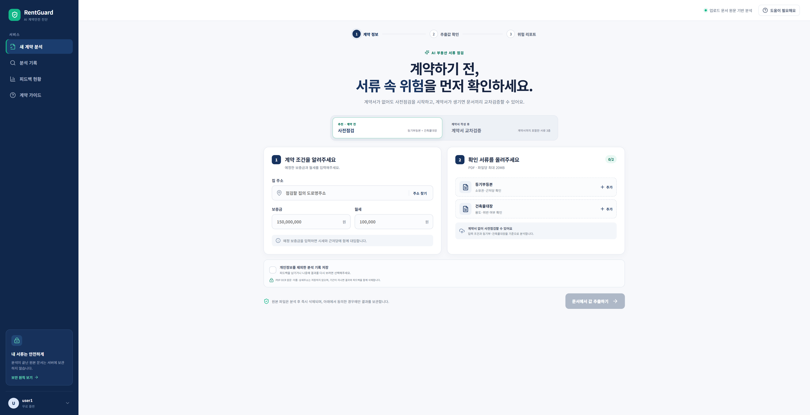
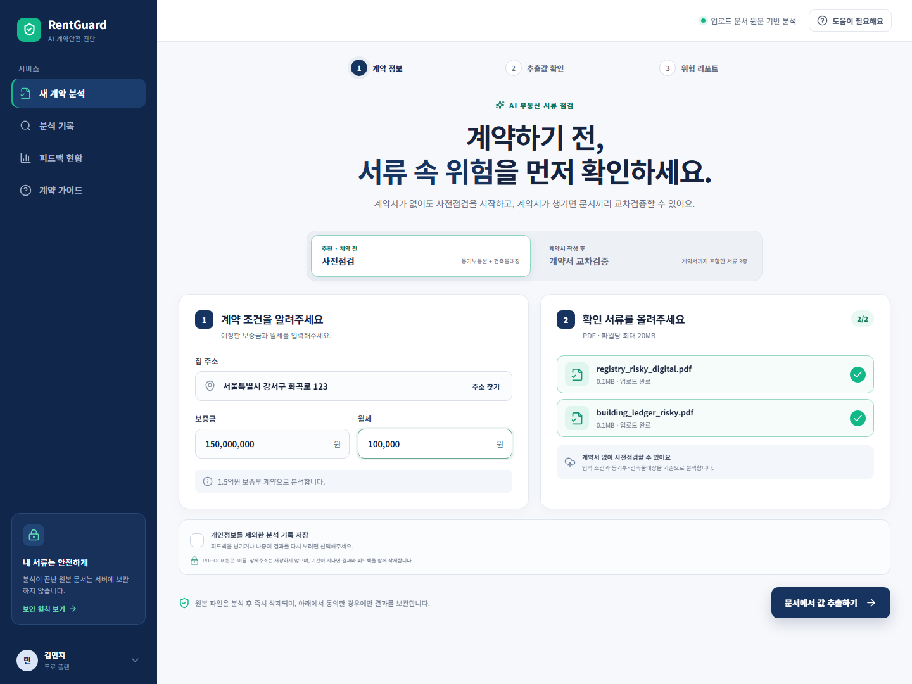
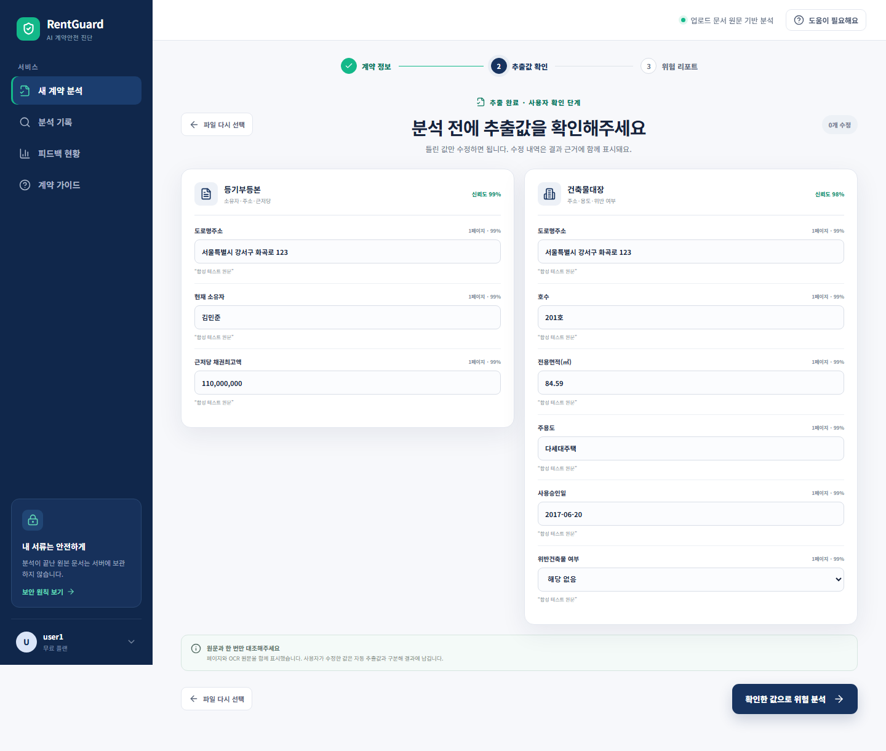
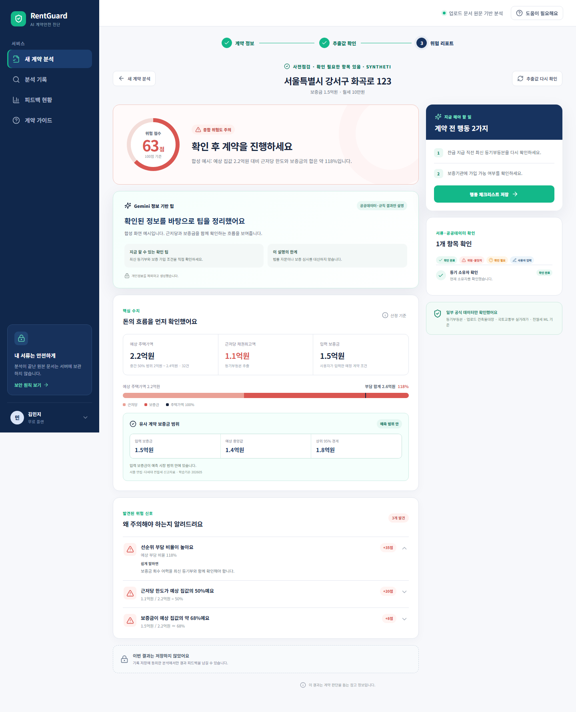
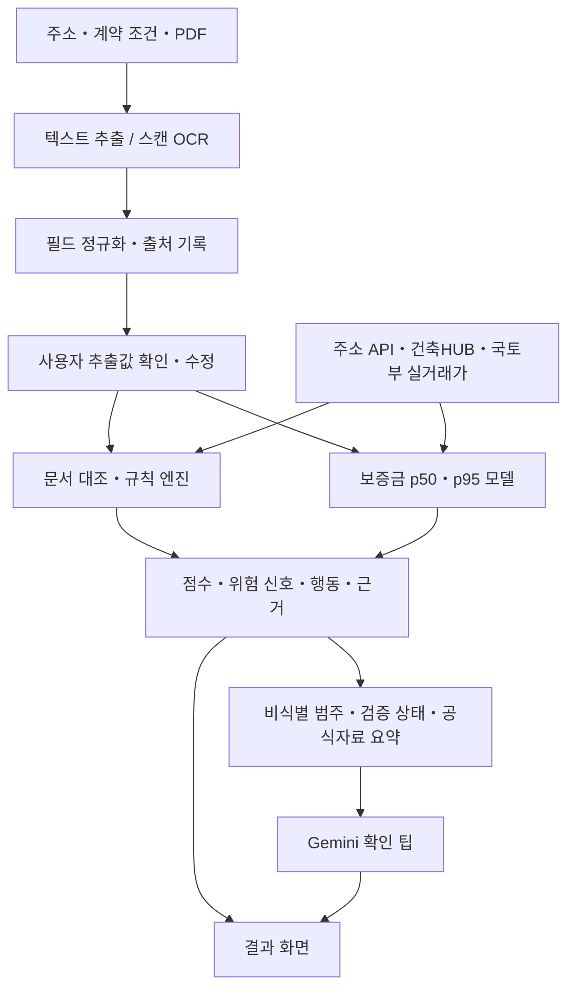

# RentGuard AI

**등기부・건축물대장・계약서를 대조해, 계약 전에 확인할 위험 신호와 그 근거를 보여주는 서비스입니다.**

[](https://github.com/youngsuchoi0930/RentGuard/actions/workflows/ci.yml)

| 프로젝트 | 내용 |
|---|---|
| 형태・기간 | 개인 프로젝트 · 약 1개월 |
| 구현 범위 | 서비스 흐름 설계, Next.js 웹, FastAPI API, PDF/OCR 추출・교차검증, 공공 API 연동, ML 학습・평가, 회귀 테스트・CI |
| 개발 방식 | AI 코딩 도구와 협업해 구현・수정・테스트・문서화 진행. 아래에 실제 오류 사례, 설계 선택과 검증 근거 공개 |
| 실행 상태 | 로컬 웹・API 및 Docker Compose 실행 지원 |
| ML 적용 범위 | 서울 연립・다세대 전월세의 보증금 시장 범위 추정 |

[사용 흐름](#화면과-사용-흐름) · [설계](#설계와-선택-이유) · [문제 해결](#문제-해결-사례) · [성능](#모델-성능) · [실행](#실행) · [검증](#검증과-한계)

## 해결하려는 문제

계약 전 확인 정보는 여러 서류와 사이트에 흩어져 있습니다. 등기부의 소유자・근저당, 건축물대장의 용도・면적, 계약서의 임대인・금액을 따로 읽으면 **같은 물건인지, 어떤 값이 충돌하는지, 무엇부터 확인할지**를 놓치기 쉽습니다.

RentGuard는 서류를 구조화한 뒤 문서・입력값・공공데이터를 대조하고, 결과마다 출처와 다음 행동을 연결합니다. 계약서가 없는 단계에는 등기부와 건축물대장만으로 사전점검을 시작할 수 있습니다.

## 화면과 사용 흐름



위 화면은 원본 배경과 구성을 유지한 `user1` 프로필의 사전점검 첫 화면입니다. 아래 펼침 영역의 입력·추출 확인·결과 이미지는 **합성 테스트 문서와 모의 API 응답으로 재현한 실제 웹 UI**이며, 표시된 주소・인물・금액과 Gemini 문장은 시연용입니다.

| 단계 | 사용자 행동 | 서비스가 제공하는 정보 |
|---|---|---|
| 1. 계약 조건・서류 입력 | 주소・보증금・월세 입력, PDF 업로드 | 사전점검 2종, 계약서 교차검증 3종 업로드 |
| 2. 추출값 확인 | 문서에서 읽은 주소・금액・면적 확인・수정 | 문서・페이지・원문・추출 방식・신뢰도, 수정 전후 이력 |
| 3. 결과 확인 | 위험 근거와 확인 순서 확인 | 규칙 점수, 유사 계약 보증금 기준, 문서 불일치, 공식 참고자료와 행동 목록 |

<details>
<summary>입력・추출값 확인・결과 화면 보기</summary>







</details>

## 설계와 선택 이유



| 선택 | 이유와 구현 |
|---|---|
| 규칙・ML・LLM의 역할 분리 | 규칙은 점수와 확인 순서를 계산하고 ML은 유사 계약의 보증금 범위를 추정. Gemini는 확정된 범주・검증 상태와 공식자료 요약을 받아 팁 작성 |
| 추출 후 사용자 확인 | OCR 오류가 바로 계산값이 되지 않도록 두 단계 API로 분리. 수정값은 원래 추출값과 구분해 추적 |
| PDF 텍스트 우선, OCR fallback | 텍스트 레이어가 있으면 직접 추출하고 스캔 문서는 PaddleOCR로 처리 |
| 필드의 의미・문서 영역으로 파싱 | 주소・소유자・채권최고액 표식을 활용하고 반복되는 권리・소유권은 배열로 관리 |
| 부족한 근거를 명시 | 비교 거래 부족・API 장애・추출 실패는 `unavailable` 또는 `needs_review`. 시세가 없으면 시세 대비 비율 계산 보류 |
| 최소 정보 저장・전송 | Gemini에는 PDF・주소・이름・금액・증거 원문을 보내지 않음. 기록은 명시적 동의 시에만 저장, 7・30・90일 보관 및 삭제 지원 |

공식자료 검색은 **검수된 HUG・국토부・정부24 카탈로그에서 위험 신호・검증 상태에 따라 자료를 선택하는 방식**입니다. 벡터 DB 기반 의미 검색과는 구현 범위가 다릅니다. [선택 로직](apps/api/app/services/official_guidance.py)

위험점수는 사고 확률이 아닌 **제품 내부의 확인 우선순위**입니다. 활성 신탁에는 30점, 근저당 비율 50% 이상에는 20점을 부여하지만 이 가점은 사고 라벨로 학습・검증한 값이 아닙니다. 조건・가점・등급을 [위험 정책](docs/risk-policy-v2.md)과 [정책 manifest](docs/risk-policy-v2.json)에 공개하고 경계값 테스트로 일치 여부를 검사합니다.

## 문제 해결 사례

| 다룬 문제 | 원인과 조치 | 확인 근거 |
|---|---|---|
| 같은 집인데 주소 불일치로 표시 | 등기부 뒷장의 소유자・채무자 주소가 물건 주소로 선택됨. 표제부의 대상 물건 주소와 주소 변경 이력을 우선하고 페이지 출처 보존 | [다쪽 주소 추출 회귀](apps/api/tests/test_registry_extraction.py) |
| 띄어쓰기 차이로 주소 오탐 | OCR이 붙여 읽은 주소와 `[집합건물]` 같은 문서 표제를 정규화. 실제 다른 주소와 호수 차이는 별도 검사 | [정규화](apps/api/tests/test_cross_checker_address.py), [문서 대조](apps/api/tests/test_document_bundle.py) |
| 말소 권리・신탁 안내문을 활성 위험으로 중복 계산 | 권리 종류・순위・접수일・말소 상태를 연결하고 안내문과 실제 등기 항목 구분. 말소 권리는 위험 계산에서 제외 | [권리 추출](apps/api/tests/test_registry_extraction.py), [분석 조립](apps/api/tests/test_analysis_service.py) |
| 공공 API 장애에 따라 결과가 흔들림 | 업로드 문서의 면적・사용승인일을 우선하고 API는 보완에 사용. 실거래 일부 월 실패 시 성공 월 사용, 부족한 근거 표시 | [공공 API](apps/api/tests/test_public_data.py), [모델 추론](apps/api/tests/test_deposit_predictor.py) |
| 보증금 비교 기준에 제안 금액이 섞일 위험 | 현재 제안 보증금을 예측 특성에서 제외하고 예측 후 입력 금액과 p95 비교 | [특성 독립성](apps/api/tests/test_deposit_quantile_features.py) |

이 사례들은 코드・회귀 테스트로 확인할 수 있습니다. 실제 사용자의 검토 시간 감소나 새 문서 전체에 대한 정확도 향상은 별도로 측정하지 않았습니다.

## 모델 성능

API에 연결된 모델은 scikit-learn `HistGradientBoostingRegressor(loss="quantile")` 기반 보증금 모델입니다. 전세・월세별 p50(예상 중앙값)과 p95(상위 경계)를 제공합니다. `IsolationForest`는 실험용으로 보관하며 API에 연결하지 않았습니다.

### 같은 홀드아웃에서의 비교

국토교통부 서울 연립・다세대 전월세 신고자료 중 **2026-06~08의 30,780건**을 평가에 사용했습니다. 오차는 보증금 전체 금액 기준이며 비율오차는 각 거래 절대비율오차의 중앙값입니다.

| 지표 | 유사 거래 중앙값 기준선 | 분위수 모델 v1 | 현재 모델 v2 |
|---|---:|---:|---:|
| p50 MAE | 6,582.84만원 | 2,996.61만원 | 2,946.94만원 |
| p50 중앙 절대비율오차 | 46.38% | 14.36% | 13.93% |
| p95 포함률 | 해당 없음 | 92.28% | 95.03% |

- v2의 MAE는 단순 기준선 대비 **55.23%**, v1 대비 **1.66%** 낮았습니다.
- 기준선은 v2에 저장된 과거 학습 거래의 지역・면적대・계약형태별 ㎡당 보증금 중앙값에 대상 면적을 곱합니다. 표본 부족 시 더 넓은 그룹으로 대체합니다. 월세액・층・연식을 직접 반영하지 않는 **단순 기준선**이므로 이 비교만으로 다른 ML 모델보다 우수하다고 주장하지 않습니다.
- 기준선 비교는 README 보강 과정에서 기존 홀드아웃을 재사용한 사후 평가입니다. 새롭게 확보한 미사용 평가셋의 결과가 아닙니다.

### 개선 과정과 해석

초기 모델의 p95 포함률은 92.28%로 목표 95%보다 낮았습니다. v2에서는 p50 특성을 확장하고 전세・월세별 잔차 보정을 적용했습니다. 같은 홀드아웃에서 p95 포함률은 95.03%였고 합성 이상 조건 탐지율은 **78.83% → 75.90%로 감소**했습니다. 중앙값 오차와 상위 경계의 포함률을 우선한 선택이며 합성 탐지율 감소도 함께 공개합니다.

**보정용 2026-04~05 자료는 보정값을 고정한 뒤 최종 학습에도 재사용합니다.** 따라서 독립 보정셋을 끝까지 유지하는 split-conformal 절차와 동일한 보장을 주장하지 않습니다. 95.03%는 해당 과거 홀드아웃의 전체 포함률이며 미래 모든 조건에서의 95% 보장은 아닙니다. v1・v2 결과를 비교해 본 평가 구간이므로 이후 모델 선택에는 새로운 평가 기간이 필요합니다.

| 평가 구간 | 단순 기준선 MAE | v2 MAE | v2 중앙 절대비율오차 |
|---|---:|---:|---:|
| 전세 11,507건 | 6,091.68만원 | 2,814.94만원 | 6.69% |
| 월세 19,273건 | 6,876.09만원 | 3,025.74만원 | 24.71% |

월세는 전세보다 비율오차가 크므로 개별 계약의 확정 적정가격으로 해석하지 않습니다. p95 초과는 시장 이상 신호로 표시하며 규칙 점수에는 합산하지 않습니다.

세부 모델・학습 표본・하이퍼파라미터・합성 평가・한계는 [모델 카드](docs/model-card.md)에 있습니다. 원문 거래 없이 확인할 수 있는 [기존 평가 집계](docs/evaluation/model-reports.json), [기준선 재평가 JSON](docs/evaluation/deposit-baseline.json), [모델 manifest](models/deposit-quantile-v2.manifest.json)도 제공합니다.

## 실행

필요 환경: Node.js 22.13 이상과 pnpm 10.15.1, 로컬 API/OCR은 Python 3.12. 아래 명령은 저장소 루트 기준입니다.

1. `.env.example`을 로컬 `.env`로 복사하고 사용할 서비스 키를 설정합니다.
2. 공공데이터포털에서 **건축HUB・연립/다세대 매매・연립/다세대 전월세** 서비스별 활용신청을 확인합니다.
3. Docker Compose 또는 웹・API 개별 실행을 선택합니다.

| 설정 | 용도 |
|---|---|
| `JUSO_CONFIRM_KEY` | 도로명주소 검색・법정동 코드 확인 |
| `DATA_GO_KR_SERVICE_KEY` | 건축HUB・국토부 실거래 API. 공통 키와 별개로 각 서비스 이용 승인 필요 |
| `GEMINI_API_KEY` | 확인 팁 생성. 키 누락・호출 실패 시 규칙 결과와 공식 참고자료 제공 |
| `GEMINI_MODEL` | 사용할 Gemini 모델 ID. 기본값은 `.env.example` 참고 |

### Docker Compose

```sh
docker compose up --build
```

웹: [localhost:3000](http://localhost:3000) · Swagger: [localhost:8000/docs](http://localhost:8000/docs) · 모델 상태: [localhost:8000/health](http://localhost:8000/health)

저장소의 검증된 모델을 이미지에 포함합니다. Compose API는 모델・manifest의 파일명・크기・SHA-256을 확인하며 필수 모델이 없거나 손상되면 시작에 실패합니다. 동의한 기록은 `rentguard-data` 볼륨의 SQLite에 저장됩니다.

<details>
<summary>Windows 로컬 개별 실행</summary>

웹 터미널:

```powershell
corepack enable
corepack prepare pnpm@10.15.1 --activate
pnpm install --frozen-lockfile
pnpm dev:web
```

API 터미널:

```powershell
py -3.12 -m venv apps/api/.venv
apps/api/.venv/Scripts/python -m pip install -r apps/api/requirements.txt
cd apps/api
.venv/Scripts/python -m uvicorn app.main:app --reload --port 8000
```

최초 스캔 OCR 실행에는 모델 다운로드가 필요할 수 있습니다. 프론트와 API는 문서당 20MB 제한을 적용하며 API는 `%PDF-` 파일 서명도 확인합니다.

</details>

API 엔드포인트・수집/학습・OCR 평가・화면 캡처 재현 명령은 [개발 가이드](docs/development.md)에 모았습니다.

## 검증과 한계

2026-10-27 마무리 커밋 [20e322d](https://github.com/youngsuchoi0930/RentGuard/commit/20e322d)과 [CI 실행](https://github.com/youngsuchoi0930/RentGuard/actions/runs/40454338278) 기준입니다.

| 구분 | 확인 결과 | 검증 범위 |
|---|---|---|
| API・회귀 | 137 passed, 1 skipped | 추출・대조・권리・계산・기록・피드백・LLM 등. 기본 실행의 skip은 선택 OCR 테스트 |
| 합성 PDF | 30건・90페이지・480개 필드 통과 | 지정한 합성 레이아웃의 정답 일치. 실제 문서 전체의 정확도를 의미하지 않음 |
| 브라우저 | 9 passed | **API 모킹 기반** 입력→확인→결과・오류 UX・키보드・모바일・콘솔 검사. 실제 OCR/공공 API/Gemini를 묶은 통합 검증과 구분 |
| 접근성 | serious・critical 위반 0건 | Chromium 초기 화면 axe WCAG A/AA 자동 검사와 핵심 키보드 이동. 전 화면・수동 감사는 미실시 |
| 빌드・의존성 | lint/build 통과, 알려진 취약점 0건 | 검사 시점 pnpm/pip-audit 결과. CI에서 계속 검사 |
| 스캔 OCR | 별도 워크플로 | 이미지 PDF 10건・30페이지 수동・주간 실행, 기본 CI와 분리 |

비공개 문서는 별도 회귀검증에 사용하고 Git에 넣지 않습니다. [비공개 홀드아웃 평가 방법](docs/private-holdout-guide.md)은 공개하며 개인 서류는 ML 학습・보정・성능평가에 포함하지 않습니다.

남은 과제는 다음과 같습니다.

- 실제 사용자 검토 시간・오탐 경험, 분석 지연시간 p50/p95・동시 요청 성능 측정.
- 새 문서 레이아웃・손글씨 계약서・새 평가 기간에서의 검증 확대.
- 보정셋 재사용 없는 보정 절차, 월세 예측 개선, 같은 특성을 사용하는 다른 모델과의 비교.
- 서울 연립・다세대 밖 유형・지역 확장과 인증・권한・운영 관측 검증. 현재 공개 배포는 하지 않았습니다.

보증사고・사기 정답 라벨이 없어 사고 예측 정확도・F1을 제시하지 않습니다. 건축HUB 응답에 위반건축물 플래그가 없거나 보증 가입 여부를 자동 확인할 수 없으면 원문・기관 확인을 안내합니다.

## 코드와 문서

| 경로 | 역할 |
|---|---|
| [apps/web](apps/web) | Next.js・React UI, 추출값 확인・결과・기록・피드백 |
| [apps/api](apps/api) | FastAPI, 파서・대조・규칙・공공 API・모델 추론・SQLite |
| [scripts](scripts) | 공공자료 수집, 학습・평가, 합성 PDF 생성 |
| [models](models) | 신뢰하는 학습 모델과 무결성 manifest |
| [모델 카드](docs/model-card.md) | 모델 상세・평가 수치・보정 방식・한계 |
| [개발 가이드](docs/development.md) | API・실행・수집/학습・재현 명령 |
| [위험 정책](docs/risk-policy-v2.md) | 위험 규칙과 가중치의 제품 내부 정의 |
| [HANDOFF.md](HANDOFF.md) | 상세 인수인계 및 현재 구현 상태 |
